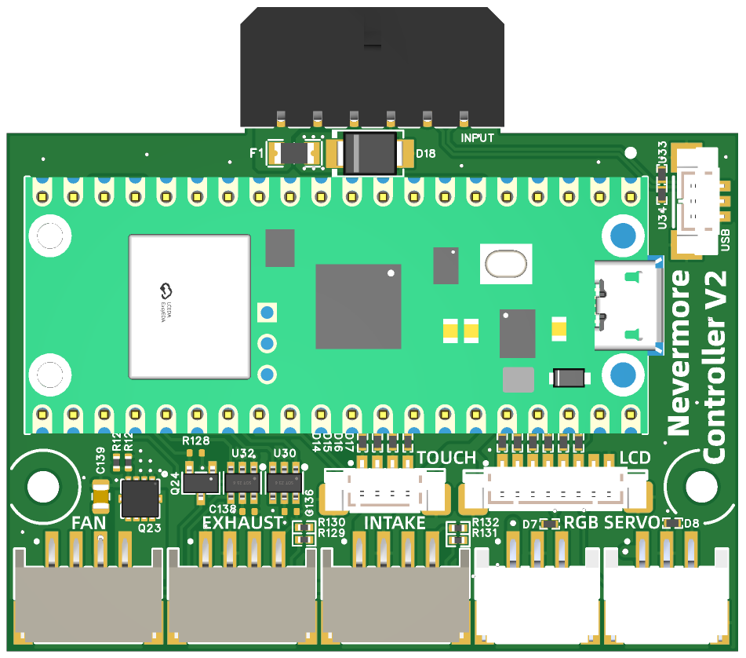
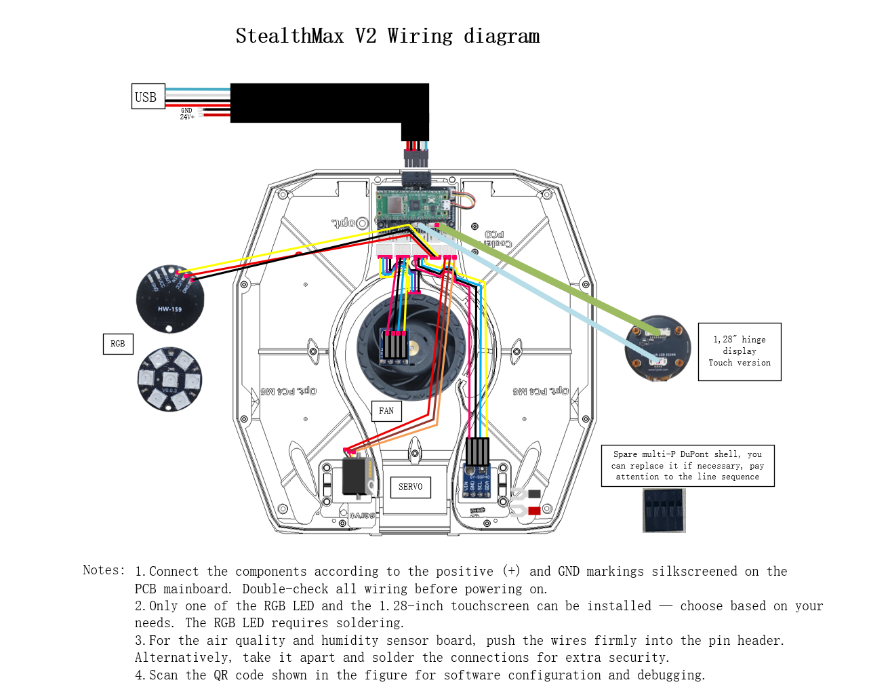

 # 1.Introduction

  This is a shield board based on the Raspberry Pi Pico. It has been tested on the Pico W and is fully compatible with the requirements of the StealthMax V2, greatly simplifying wiring and saving installation difficulty and time!
 # 2. Features
- Compact size: 60*50mm (mounting hole spacing 54mm)
- 3.5mm female header height, meeting low-profile installation requirements
- Onboard 24V to 5V@2A circuit, meeting higher current demands
- Supports multiple fan interfaces: 2-pin/3-pin/4-pin
- Replaceable Pico module
- Selectable 5V power supply
- Supports 1.28-inch screen
 # 3. Applications
- StealthMax V2
 # 4. Wiring Diagram
 